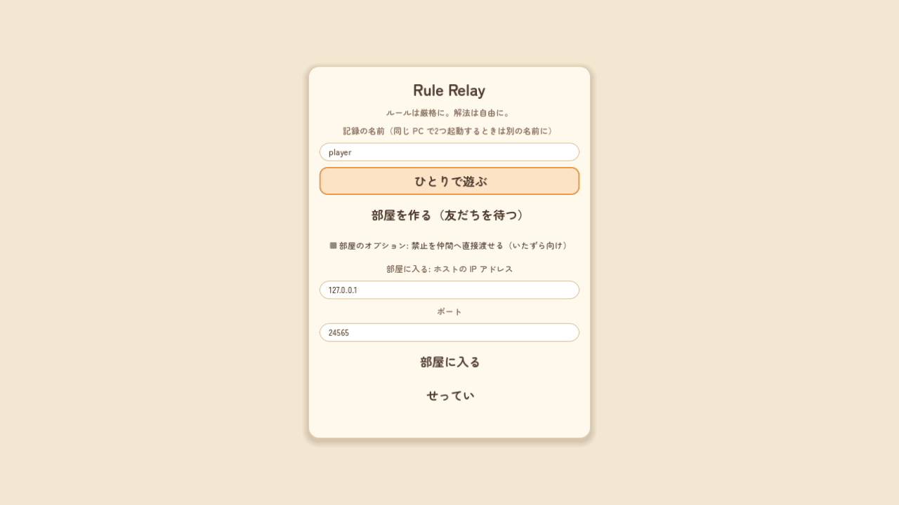
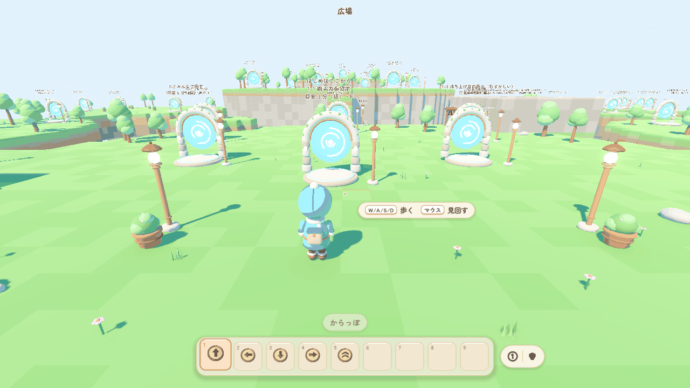
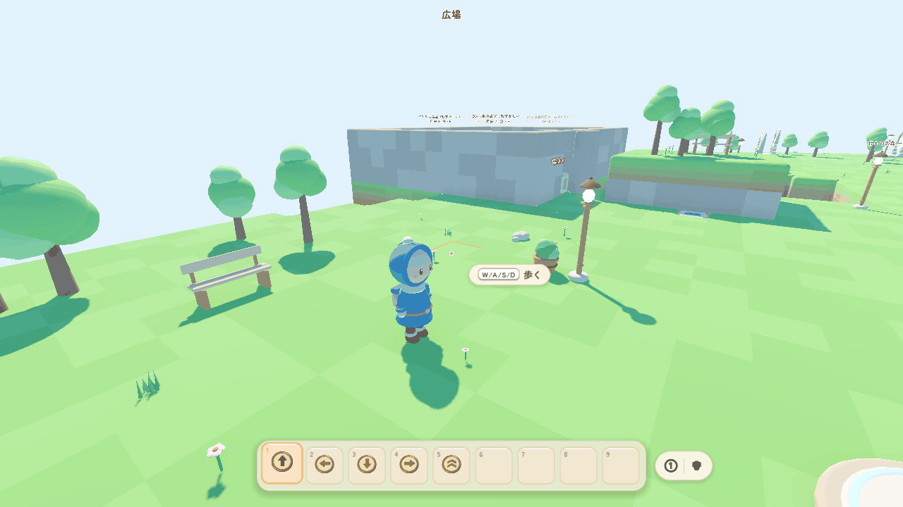
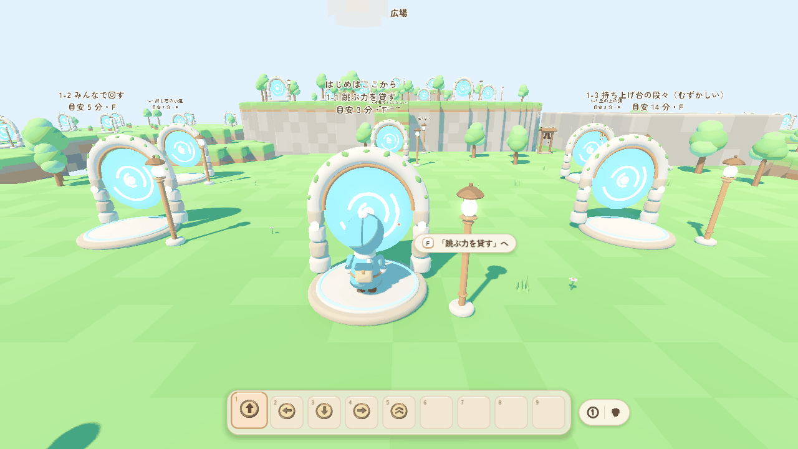
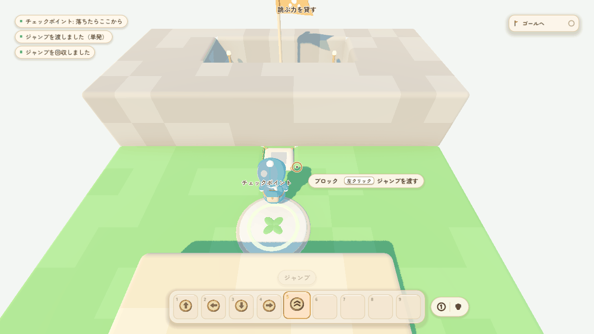
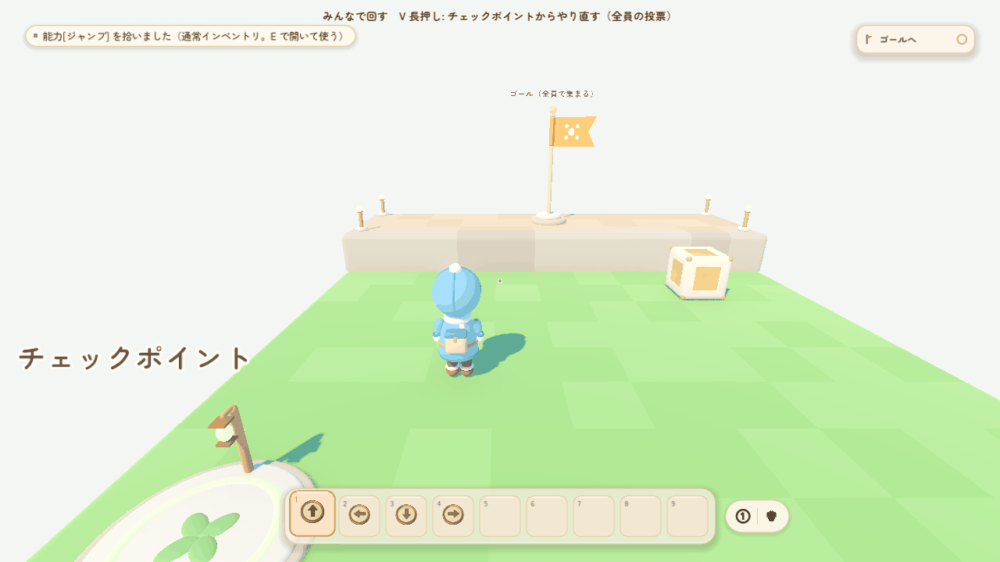
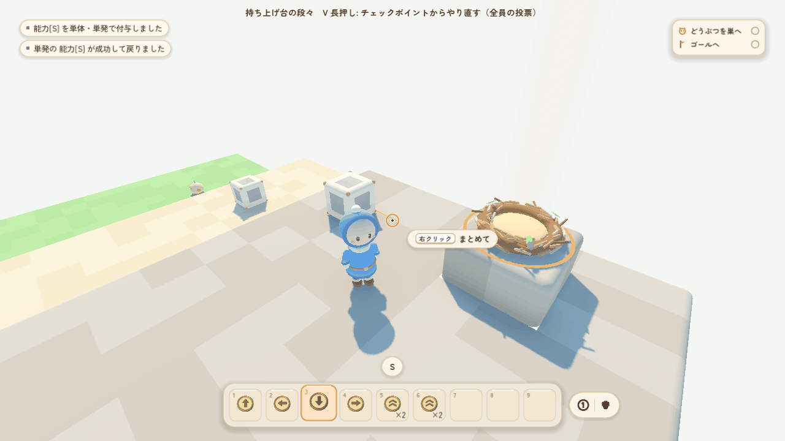
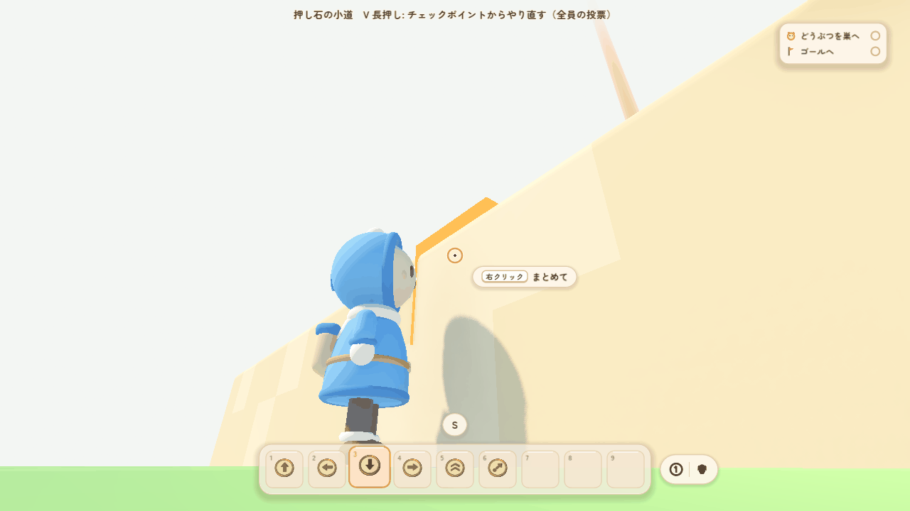

# はじめての 10 分の通し（2026-11-22、v0.3.0 の後）

- 目的: 本人の次の試遊の前に、初めて遊ぶ人がつまずく所を先に見つける。v0.3.0 までの不満（巣が分からない・床が抜ける・メニューの言葉が怖い・渡す表示がごちゃごちゃ・狙いがずれる・生き物が反応しない）は、どれも手で遊んで初めて出て、自動テストでは見えなかった。
- やり方: `tools/capture_first_ten_minutes.gd`（lavapipe ＋ xvfb、Forward+、1280×720、`--fixed-fps 60`）。ゲームと同じ入力（キーの押し下げと押し離し）で、人の速さで通す。瞬間移動はしない。視点はマウスと同じ速さの上限（1 秒に 4.5 rad）で回す。
  - 流れ: 起動 → タイトル → ひとりで遊ぶ → 広場 → 最初のポータル → 1-1〜1-4（入る・目的を読む・渡す・F で回収・解く・クリア）→ 広場のポータルの前 → 一時停止のメニュー・持ち物・せってい を 1 回ずつ。
  - 1-1 は渡して、F で回収して、もう一度渡す。1-3 は石を押した直後、まだ動いている間にもう一度 S を押す。1-4 は地形のセルを押して、落ちている最中に撮る。
  - 持ち物の中で並べ替えるときだけ、マウスで指す代わりに、選んだ状態にしてから番号キーを押した。
  - 撮り方: `docs/reports/first-ten-minutes/`（画面の文字は、撮った場面ごとに `moments.txt` へ書く。スクリプトの出力先で見る）。
- 撮った画面は 2 組ある。
  - 直す前（`before-*.png`）: main（v0.3.0、`a1f9a29`）。
  - 直した後（番号だけのもの）: このブランチ。
- 自動の通しは答えを知っているので、迷う時間は測れない（所要時間は人の下限にもならない参考値）。見た目は lavapipe での描画で、Windows 実機の GPU では未確認。

## まとめ

- **いちばん困るのは「拾った能力がどこへ行ったか分からない」**。1-2 と 1-3 では、拾った・動物から回収したジャンプがかばんに入り、ホットバーに出てこない。E を開いて移さないと先へ進めないのに、知らせは「通常インベントリ」（持ち物の画面は「かばん」）だった。行き止まりに見える。
  - 知らせと照準の下の案内で、かばんの場所を示すようにした。
  - 拾った物を自動でホットバーへ入れる案は、企画書 7（F で拾った物は通常インベントリへ）を変えるので、本人に戻す。
- **クリアの瞬間に内部の言葉が出ていた**。
  - 報酬の知らせ「初回クリア の報酬: tmp_hub_lantern_intro、…」。
  - カード「高台に到達しました・（仮のゴール）」。
  - 上の札「付与 2 回・受け渡し 0 回」。これは右上の目的の札まで伸びて重なっていた。
- **ひとりなのに「全員」「チーム」が並ぶ**。
  - 上の札の「V 長押し…（全員の投票）」が、いつも出ていた。
  - チェックポイントの知らせが「チーム共通…全員復活」だった。
  - ゴールの看板が「ゴール（全員で集まる）」だった。
- **案内と知らせの言い方がずれていた**。案内は「ジャンプを渡す」なのに、知らせは「能力[ジャンプ] を単体・単発で付与しました」。
- **直していない大きなもの**:
  - 段の真下で見上げると、カメラが地面に当たって寄る。画面が壁とキャラクターの顔だけになる。
  - 単発で貸した S/W を使うキーが、自分の歩くキーと同じ（崖の縁で押すと自分も動く）。
  - どちらもカメラとルールの設計に関わるので、本人に戻す。

## 見つけたこと

重さ: 高 = 先へ進めない・意味を取り違える、中 = 迷う・ごちゃごちゃ、低 = 気になる程度。

| 場所 | 何が起きる | なぜ困る | 重さ | 直したか |
|---|---|---|---|---|
| 1-2・1-3 拾う／動物から F | 拾ったジャンプはかばんに入り、ホットバーに出てこない。知らせは「…を拾いました（通常インベントリ。E で開いて使う）」で、動物から回収したときは場所を言わない | 拾ったのに使えない。E を開いて移さないと進めない（行き止まりに見える）。持ち物の画面は「かばん」と言う | 高 | 一部。知らせを「かばんへ。E で開いてホットバーへ」にし、ホットバーに空きがあるあいだ照準の下に「[E] かばんの能力をホットバーへ」（持ち物を 3 回開いたら出ない）。自動でホットバーへ入れるかは本人の判断 |
| クリア | 「初回クリア の報酬: tmp_hub_lantern_intro、tmp_cosmetic_intro、…」 | 内部の ID が出ている。長くてクリアのカードの下まで伸びる | 高 | 直した（「はじめてのクリア！ 広場がにぎやかになります」。中身が仮なので名前は出さない） |
| 広場に戻った後 | 「はじめはここから」がクリア済みの 1-1 に残る。戻った向きでは次の門が画面の外 | 次にどこへ行けばよいか分からない | 高 | 一部。次の門の看板を「つぎはここ」にした。戻ったときの向きは変えていない |
| 段の真下（1-4 の縁のセル） | 見上げると、カメラのばねが地面に当たって寄り、壁とキャラクターの顔だけになる。縁のセルの上面が見えず狙えない | カメラが埋まる。狙いが厳しい | 高 | 未（カメラ。見上げの上限 30° を下げるとテストの狙いにも響くので、本人と決める） |
| タイトル | IP アドレス・ポート・「部屋のオプション: 禁止を仲間へ直接渡せる（いたずら向け）」・「同じ PC で2つ起動するときは別の名前に」が最初の画面に並ぶ | 初めての人に技術の言葉。どれを押すか迷う | 中 | 直した（「友だちと遊ぶ」を選んだときだけ出す） |
| 島に入った直後 | ホットバーの上に「からっぽ」が出る（W を選んでいるのに） | 能力が無いように読める | 中 | 直した（島を作った直後は能力を配る前だった。最初の表示では名前を出さない） |
| 上の札 | ひとりでも、いつも「V 長押し: チェックポイントからやり直す（全員の投票）」 | 常に出ている操作説明。ひとりなのに「全員」。目安の時間を過ぎた後の案内「長押しでやり直し」と二重 | 中 | 直した（協力中だけ） |
| チェックポイントの知らせ | ひとりでも「チェックポイントがチーム共通になりました（台座で F: 全員復活）」 | ひとりには意味が無い | 中 | 直した（ひとりは「チェックポイント: 落ちたらここから」） |
| 1-1 台座の上で渡す | 「チェックポイントにできません（ジャンプを遠くに貸したままです（手元に戻してから台座に触れてください））」 | もう有効な台座なのに、何もしていないのに断られたように読める。かっこが二重 | 中 | 直した（有効な台座では言わない） |
| 知らせ | 「能力[ジャンプ] を単体・単発で付与しました」「単発の 能力[ジャンプ] が成功して戻りました」「付与方式: 繰り返し」 | 案内（「ジャンプを渡す」）と言い方がずれる。記号のかっこ | 中 | 直した（「ジャンプを渡しました（単発）」「ジャンプが戻ってきました」「渡し方: 繰り返し」） |
| クリアのカード | 「高台に到達しました／どの順番でたどり着いても正解（仮のゴール）」 | 目的は「ゴールへ」。「仮」が見える | 中 | 直した（「クリア！」とステージの名前） |
| 上の札（クリア） | 「クリア！ 0 分 11 秒（目安 3 分）・付与 2 回・受け渡し 0 回」が札に足され、右上の目的の札に重なる。左上の知らせにも同じ文 | 重なり。同じ文が 2 か所。「付与」「受け渡し」の回数は初めての人に意味が無い | 中 | 直した（札には出さない。文は時間だけ。回数は記録に残る） |
| 3D の「チェックポイント」 | 台座のそばで画面の端からはみ出すほど大きく、照準の下の案内に重なる | 重なり | 中 | 直した（門の文字と同じく、近いと画面での大きさを止める） |
| 広場の遠い門の文字 | 数ピクセルの読めない線が広場じゅうに散らばる | ごちゃごちゃ | 中 | 直した（24〜32 m より遠い門の文字を消す） |
| 生き物を狙う | 照準の下に「左クリック Wを渡す」「1〜9 えらぶ」「左クリック 移動の能力を渡すと歩き出す」「F 回収」が並び、画面の右端からはみ出す | 左クリックが 2 つ。行が長い | 中 | 直した（移動の無い生き物には左クリックを 1 つだけ。かばんの案内は何かを狙っているときは出さない） |
| ホットバー | ジャンプが 2 枠にあると、両方に「×2」 | 4 つ持っているように見える | 中 | 直した（その能力の最初の枠にだけ） |
| 単発の S/W を使う（1-3 の石・1-4 のセル） | 貸した S を使うキーが自分の後ろ歩きと同じ。押すと自分も後ろへ動き、体の向きも変わる | 崖の縁で押すと自分が落ちそうになる | 中 | 未（ルールの設計。本人の判断） |
| 地面のセルを狙う（1-4） | 地面のセルには名前も「Sを渡す」も出ない（初めのうちは地面に案内を出さない設計）。夕日色の輪郭だけ | どのセルが選ばれたか分かりにくい。1-4 は地面に渡す最初の場面 | 中 | 未（設計の意図がある。ステージ側の教え方と合わせて決める） |
| 持ち物の W の説明 | 「ブロックに渡すと北へ1マス動く」 | 画面に方角が無いので「北」が分からない | 中 | 未 |
| 1-1 台座のそばからブロックを狙う | 窪みのブロックがキャラクターの体に隠れる（照準の下に「ブロック」とは出る） | 何を狙っているか目で見えない | 低 | 未（カメラ） |
| ゴールの看板 | ひとりでも「ゴール（全員で集まる）」 | 目的の一覧（ひとりは「ゴールへ」）と食い違う | 低 | 直した（「ゴール」。「全員で」は目的の一覧が言う） |
| 広場の門の文字 | 「目安 3 分（仮）」 | 開発の注記が見える | 低 | 直した |
| 持ち上げ台に乗っている間・ゴールの中 | 地面を見ているだけで「右クリック まとめて」 | 場面に合わない案内 | 低 | 直した（地面と生き物を狙っているときは出さない） |
| 広場の近い門の文字 | 1-1 と 1-3 のように近い門の看板どうしが重なる | 読みにくい | 低 | 未 |
| 広場に戻った直後 | 住む生き物（うさぎ）がカメラのすぐ前で画面の下を塞ぐ | 景色とホットバーの手前が隠れる | 低 | 未（住む場所の置き方） |
| 生き物の願いの文 | 3D の文字がホットバーの裏に重なることがある | 重なり | 低 | 未 |

確かめて問題が無かったこと:

- 一時停止のメニュー（広場）・せってい・持ち物の画面に、文字の重なりや、はみ出しは無かった。広場のメニューは「つづける／せってい／ゲームをやめる」だけ。
- 目的の大きな札は 3 秒で右上へ縮み、行は鐘・どうぶつ・ゴールの順でそろっている。
- 「歩く」「見回す」の案内は少し歩くと消え、そのあと出続けることは無かった。
- 単発のジャンプの間合い: ブロックが跳んでいる最中に W を押し続けても岩棚へ移れた。
- 1-3 の石を、まだ動いている間にもう一度 S を押しても、二重には動かなかった（貸した S は 1 回で戻る）。

## 画面

### タイトル

直す前は、部屋の項目が全部並んでいた。直した後は「友だちと遊ぶ」で開く。

### 広場に来た・最初のポータル

- 分かること: 正面の門が最初。看板は「はじめはここから」。
- 遠い門の文字は消した。近い 3 つは読める。

### 1-1 跳ぶ力を貸す

- 分かること: 目的は「ゴールへ」。旗は見える。
- ブロックにジャンプを渡し、Space で跳ばせ、F で戻せる。

台座の上で渡したとき。直す前は「付与」「チーム共通」と、断る知らせが並んでいた。

クリアの瞬間。直す前は、報酬の ID・「高台に到達しました（仮のゴール）」・長い札が重なっていた。

### 1-2 みんなで回す

- 分かること: 足もとのジャンプを F で拾う。
- 拾ったジャンプはかばんに入るので、E で開いてホットバーへ移す。

### 1-3 持ち上げ台の段々

- 分かること: 動物のジャンプを F で借りる。
- 持ち上げ台で上がる。石を落として段にする。動物にジャンプと移動を渡す。

石を押した後。直す前は、ジャンプの 2 枠が両方とも「×2」と出ていた。押した人も後ろを向いている。

### 1-4 押し石の小道

- 分かること: 段の縁の地面のセルに S を渡して押し、階段を作る。溝を埋める。
- 1 回目の通しでは段の真下から狙い、カメラが地面に寄って縁のセルを狙えなかった（下の画面）。2 回目は少し下がって狙った。

### 広場に戻って、メニュー

## ステージ側（別担当）

W1 の教え方を作り直している担当へ。ステージの形と、ステージの中の案内には触っていない。

- **1-2 みんなで回す**: ひとりでは、足もとのジャンプを拾って 1 段跳ぶだけでクリアする（自動で 9 秒）。「回す」も台のブロック（stool）も使わない。拾ったメダルは足もとにあって、カメラから見えにくい。
- **1-2・1-3 の拾う物**: 拾った物はかばんに入る。ホットバーへ移す操作を教える最初の場面になっているが、ステージの中では何も教えていない（画面側で照準の下の案内を足した）。
- **1-3 持ち上げ台の段々（★・目安 14 分）**:
  - 浜の動物が持っているジャンプを F で借りられることが伝わらない。吹き出しは「移動がほしい・巣」。
  - 石を押し落とすと段になる、という手がかりが無い。
  - W1 の 3 番目で、いきなり手数が多い。
- **1-3・1-4 の単発の S/W**: 押した人も同じキーで後ろ／前へ歩く。縁で石やセルを押す置き方だと、自分が縁へ寄る。
- **1-4 押し石の小道**:
  - 地面のセルに渡す最初の場面。なのに、地面には案内も名前も出ない（設計どおり）。
  - 段の真下から縁のセルを狙うと、カメラが地面に寄って狙えない。少し下がれば狙える。
  - 「押すと落ちて段になる」は、試さないと分からない。
- **1-4 巣の光の柱**: 原っぱから見ると、画面を縦に横切って上の札に重なる。遠くからの目印としては役に立っている。

## 直した場所（コード）

| 直したこと | ファイル |
|---|---|
| タイトルの部屋の項目をたたむ | `src/ui/title_menu.gd` |
| 次の門（つぎはここ）・看板の「（仮）」・遠い門の文字 | `src/stages/overworld.gd`・`src/game/overworld_portal.gd`・`src/stages/stage_world.gd` |
| 3D の文字の大きさ（チェックポイント・ゴールなど） | `src/ui/key_label_3d.gd` |
| からっぽ・×2・クリアのカード・照準の下の案内（かばん・生き物・まとめて） | `src/ui/hud.gd`・`src/ui/player_input.gd` |
| 上の札 | `src/ui/party_banner.gd` |
| チェックポイントの知らせ・断り | `src/stages/checkpoint_watch.gd` |
| クリアの文・報酬の知らせ | `src/stages/party_director.gd` |
| 知らせの言い方（渡す・戻る・回収・拾う・かばん） | `src/rules/rule_token.gd`・`src/game/world_queries.gd`・`src/game/world_ticks.gd`・`src/game/game_world.gd`・`src/game/world_item.gd`・`src/game/world_lending.gd` |

テスト:

- 新しく足した: `tests/integration/test_first_ten_minutes.gd`（ひとりの札・チェックポイントの知らせと断り・渡した知らせ・クリアの文と報酬・かばんの案内・×2）。
- 書き足した:
  - `test_title_settings.gd`（部屋の項目をたたむ）
  - `test_campaign_plan.gd`（つぎはここ・仮が無い）
  - `test_portal_return.gd`（遠い門の文字）
- 言い方の変更に合わせて直した: `test_hud.gd`・`test_first_timer.gd`（ひとりの知らせ）・`test_steam_transport.gd`（タイトルの項目）。

## 本人に決めてほしいこと

1. 拾った能力（落ちている物・動物から回収した物）を、ホットバーに空きがあれば自動でそこへ入れるか。企画書 7 は「通常インベントリへ」。今回は案内を足しただけ。
2. 見上げたときにカメラが地面に寄る件。見上げの上限（いま 30°）を下げるか、カメラの中心を上げるか。
3. 単発で貸した W/A/S/D を使うキーが、自分の歩くキーと同じこと（使うと自分も 1 歩動く）。
4. 広場に戻ったとき、体と視点を次の門へ向けるか（いまは門が横に見える向き。ADR 0020）。
